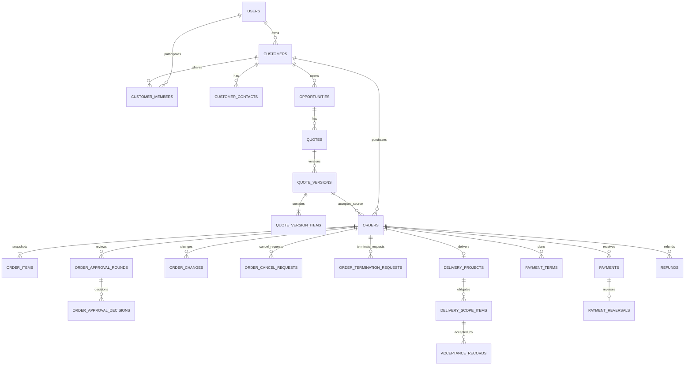

# Nexus CRM — 数据库概念与逻辑设计

- 版本：V0.2 / 2026-10-29（DC-001/008/009/011/012）
- 状态：**技术设计草案**；BR-001～BR-010 为已确认业务基线，具体字段、约束、实体粒度是待开发验证的设计决定。
- 技术基线：MySQL 8（InnoDB、utf8mb4），Prisma，NestJS；单企业内部系统，不设 tenant_id。
- 目的：指导下一步 Prisma Schema、初始 Migration 与真实 MySQL 集成测试；**本文件不是可执行 DDL**。

## 1. 边界与建模原则

1. 业务主线：客户 → 商机 → 报价（版本）→ 订单（合同快照）→ 交付、应收和收款。
2. 使用模块化单体、共享 MySQL；跨模块的数据库事务可以在同一数据库内完成，但必须显式定义锁顺序与写入边界。
3. `orders.status` 仅描述订单业务状态；交付、审批、收款/退款有独立的状态与记录。
4. 不可变事实采用追加记录/版本：报价已提交版本、订单确认快照、审批决定、确认收款和冲正，不允许普通 CRUD 覆盖。
5. 主键建议 `BIGINT UNSIGNED` 自增（与 Prisma/MySQL 实际映射须验证），对外订单号另设唯一 `order_no`。Node JSON 接口将 BigInt 转成字符串，避免 JavaScript 精度问题。
6. 金额以 `DECIMAL(18,2)` 表示人民币；计算用 Decimal，不使用 JS `number` 浮点金额；币种 `currency CHAR(3)`，V1 仅 CNY，未来再扩展多币种精度规则。
7. 时间采用 `DATETIME(3)` 并规定应用写入 UTC；业务展示转换时区。各表按需设置 `created_at`、`updated_at`、`created_by`、`version`，不机械给关联表添加软删字段。
8. 业务数据以停用、归档、作废和状态转换为主；有合同或审计价值的历史记录不级联删除。物理删除仅限未使用的草稿或有明确数据清理流程。

## 2. 逻辑 ER（主线，省略关联明细）

**ER 解释：** `QUOTE_VERSIONS → ORDERS` 绘制为 1:N 是保守建模，是否限制同一报价版本只能形成一张正式订单为 V1 业务假设（建议先加约束阻止重复生效订单）。`ORDERS → DELIVERY_PROJECTS` V1 暂定 1:0..1；客户与服务目录之间无直接强制关系。

## 3. 核心表清单（建议分批建设）

| 模块 | 表 | 用途/核心字段（除 id、常规审计列外） | 关键约束或索引 |
|---|---|---|---|
| Identity | `users` | `login_name`, `password_hash`, `name`, `department_id`, `status`, `credential_version` | `UNIQUE(login_name)`；离职停用，不删历史用户 |
| Identity | `departments` | `parent_id`, `name`, `status` | `INDEX(parent_id)`；团队范围需要明确部门层级规则 |
| Identity | `roles` | `code`, `name`, `status` | `UNIQUE(code)` |
| Identity | `permissions` | `code`, `description` | `UNIQUE(code)` |
| Identity | `user_roles` | `user_id`, `role_id` | `UNIQUE(user_id, role_id)` |
| Identity | `role_permissions` | `role_id`, `permission_id`, `scope_code` | `UNIQUE(role_id, permission_id)`；动作和固定范围成对求值，禁止跨角色拼接 |
| Identity | `refresh_sessions` | `user_id`, `token_hash`, `expires_at`, `revoked_at` | `UNIQUE(token_hash)`；仅存令牌哈希 |
| CRM | `customers` | `name`, `normalized_name`, `credit_code`, `owner_id`, `status`, `version` | 对非 NULL 规范化信用代码设唯一索引；`INDEX(owner_id,status)`；名称非唯一 |
| CRM | `customer_members` | `customer_id`, `user_id`, `member_role` | `UNIQUE(customer_id,user_id)`；协作成员与主负责人单独表达 |
| CRM | `customer_contacts` | `customer_id`, `name`, `phone`, `email`, `is_primary` | `INDEX(customer_id)`；主联系人唯一需按业务/DB能力单独实现 |
| CRM | `opportunities` | `customer_id`, `owner_id`, `title`, `stage`, `expected_amount`, `closed_at` | `INDEX(customer_id,stage)`, `INDEX(owner_id,stage)` |
| CRM | `follow_ups` | `customer_id`, `opportunity_id?`, `author_id`, `content`, `next_follow_up_at` | `INDEX(customer_id,created_at)`；作者历史保留 |
| Catalog | `service_products` | `code`, `name`, `base_price`, `status` | `UNIQUE(code)`；停用不会改变历史报价 |
| Quote | `quotes` | `opportunity_id`, `quote_no`, `status`, `current_version_no` | `UNIQUE(quote_no)` |
| Quote | `quote_versions` | `quote_id`, `version_no`, `status`, `amount`, `accepted_at`, `valid_until`, `content_hash` | `UNIQUE(quote_id,version_no)`；提交后不可变 |
| Quote | `quote_version_items` | `quote_version_id`, `product_id?`, `description_snapshot`, `quantity`, `unit_price`, `amount` | `INDEX(quote_version_id)`；保存服务与价格快照 |
| Order | `orders` | `order_no`, `customer_id`, `opportunity_id`, `source_quote_version_id`, `status`, `contract_amount`, `currency`, `version`, `effective_scope_version`, `delivery_manager_id?` | `UNIQUE(order_no)`；`INDEX(customer_id,status)`；`INDEX(status,created_at)`；交付经理 FK |
| Order | `order_items` | `order_id`, `source_quote_item_id?`, `description_snapshot`, `quantity`, `unit_price`, `amount` | `INDEX(order_id)`；已确认内容不能普通 PATCH |
| Order | `order_approval_rounds` | `order_id`, `round_no`, `snapshot_hash`, `status`, `submitted_by`, `submitted_at` | `UNIQUE(order_id,round_no)`；每次重新提交形成新轮次 |
| Order | `order_approval_decisions` | `approval_round_id`, `approver_id`, `decision`, `reason`, `decided_at` | 单决策轮次建议 `UNIQUE(approval_round_id)`（V1 单级审批） |
| Order | `order_changes` | `order_id`, `base_order_version`, `status`, `before_snapshot`, `after_snapshot`, `approved_by` | `INDEX(order_id,status)`；审批生效时锁订单并改当前合同数据 |
| Order | `order_cancel_requests` | `order_id`, `status`, `reason`, `financial_disposition`, `requested_by`, `decided_by` | `INDEX(order_id,status)`；待决申请唯一性需应用锁与数据库约束配合 |
| Order | `order_termination_requests` | `order_id`, `status`, `settlement_amount`, `reason`, `decided_by` | `INDEX(order_id,status)`；保留结算快照 |
| Delivery | `delivery_projects` | `order_id`, `manager_id`, `status`, `started_at`, `scope_version` | `UNIQUE(order_id)`；`started_at` 为曾启动的事实，不得因暂停清空 |
| Delivery | `delivery_project_members` | `project_id`, `user_id` | `UNIQUE(project_id,user_id)`；FK；明确项目分配，不代替任务/验收契约 |
| Delivery | `delivery_scope_items` | `project_id`, `scope_version`, `description`, `required`, `status`, `superseded_at` | `INDEX(project_id,scope_version)`；有效范围的判定规则须固化 |
| Delivery | `acceptance_records` | `scope_item_id`, `accepted_by`, `status`, `evidence_ref`, `accepted_at` | `INDEX(scope_item_id,accepted_at)`；拒绝/重验收均保留历史 |
| Finance | `payment_terms` | `order_id`, `term_no`, `due_amount`, `due_at`, `status`, `plan_version` | `UNIQUE(order_id,plan_version,term_no)`；计划不是到账事实 |
| Finance | `payments` | `order_id`, `amount`, `currency`, `status`, `external_reference`, `confirmed_by`, `confirmed_at` | `INDEX(order_id,status)`；确认后不直接删除或改金额 |
| Finance | `payment_reversals` | `payment_id`, `amount`, `reason`, `created_by`, `confirmed_at` | `UNIQUE(payment_id)`（V1 一笔确认收款最多一次全额冲正） |
| Finance | `refunds` | `order_id`, `payment_id?`, `amount`, `status`, `approved_by`, `paid_at` | `INDEX(order_id,status)`；批准与实际退回分开 |
| Platform | `idempotency_records` | `scope`, `key`, `request_hash`, `fingerprint_version`, `status`, `http_status`, `response_body`, `completed_at`, `expires_at` | `UNIQUE(scope,key)`；scope=user:不可变用户ID；操作/目标进入指纹；业务与结果同事务；INDEX(status,expires_at) |
| Platform | `audit_logs` | `actor_id`, `action`, `entity_type`, `entity_id`, `before_json`, `after_json`, `request_id`, `attempt_id?`, `created_at` | `INDEX(entity_type,entity_id,created_at)`；成功审计同事务；关键命令关联尝试 |
| Platform | `command_attempts` | `attempt_id`, `actor_id`, `operation_id`, `entity_type`, `entity_id`, `request_id`, `idempotency_scope`, `idempotency_key`, `request_hash`, `status`, `started_at`, `finished_at`, `error_code`, `result_ref` | UNIQUE(attempt_id)；INDEX(status,started_at)、INDEX(idempotency_scope,idempotency_key)；状态 STARTED/SUCCEEDED/REPLAYED/FAILED/UNKNOWN；ADR-003 |

**规模说明：** 当前为核心逻辑表清单，并非要求首个迭代一次全部实现。第一个纵向闭环只需必要的 Identity、Customer、Quote、Order、Approval 与平台表；交付和财务随后引入，付款条款等前置依赖按 §8.1 处理。

## 4. 重要关系、约束和删除策略

### 客户
- `customers.owner_id → users.id`：主负责人，历史用户不删除；协作关系放在 `customer_members`。
- `credit_code` 入库前去空格、统一字符格式；缺失存 `NULL`，不要存空串占位。MySQL 唯一索引允许多个 NULL，符合“缺失时提示疑似重复”需求。
- 企业名称索引用于检索，不设 `UNIQUE(name)`，避免误杀合法客户。

### 授权关系（DC-001）
- 客户为销售授权根，商机、报价、订单通过 FK 来源链继承当前客户范围；opportunities.owner_id 及 created_by 仅责任/历史信息，不独立授予访问。orders.customer_id、opportunity_id 与来源 quote_version 的所属链必须一致，事务内验证，不能只验证各 FK 单独存在。
- role_permissions.scope_code 为固定枚举 SELF_COLLABORATOR / TEAM / ASSIGNED_PROJECT / FINANCE_RELATED / ALL / IDENTITY / AUTHENTICATED / CATALOG。SELF_COLLABORATOR 表达 SELF 或 COLLABORATOR 并集；每个权限的允许枚举由 permission-matrix.md §8 固定映射，无有效组合默认拒绝。user_roles 变更、scope 变更及角色模板版本检查/审计同事务执行。
- departments.parent_id 表达无环团队树，TEAM 动态查询当前用户部门及有效子部门；不新增通用授权规则表。用户状态、credential_version、角色和客户归属每请求查询权威库，V1 不缓存授权结果。
- orders 增加 delivery_manager_id 可空 FK users；仅 delivery:assign 命令可写。项目启动复制预分配经理，首次启动不能通过请求体自我分配。delivery_project_members(project_id,user_id) 使用复合唯一键及 FK，表示明确参与项目的成员；项目经理与成员可获必要投影，任务分配模型留待 DC-004，不能用 created_by 替代。
- 授权变更和业务写的共同锁顺序见 permission-matrix.md §4.2；客户归属更新与子资源业务写使用相同客户锁，写入事务内重验。角色/组织关系变化同样遵守协议，禁止仅在事务外鉴权。
- 受保护的 business_owner 角色模板和 role:grant_business 不开放普通权限编辑；首位负责人通过受评审初始化建立，后续不得自授或删除最后有效负责人。以固定服务校验实现，不引入复杂策略引擎。

### 报价与订单
- `quote_versions` 每次提交产生新版本，不覆盖旧版本；`quote_version_items` 保存单价和描述快照。
- `orders.source_quote_version_id` 指向已接受版本；订单同时保存自身 `order_items` 与合同金额快照，避免未来报价/服务目录变化影响历史交易。
- 订单金额与明细金额一致性由事务中的领域规则验证，金额字段更新应进入受保护的业务命令。
- 草稿订单重复生成：通过来源报价与业务唯一规则/幂等键拦截，避免仅靠页面禁用按钮。

### 收款与财务
- `payments.status` 至少区分 `RECORDED / CONFIRMED`；错误确认通过 `payment_reversals` 冲正。`REFUND` 是独立的实际退回资金活动。
- 已收金额应来源于有效已确认收款减去有效冲正；退款与订单结算指标单独定义，避免混淆“净收款”“合同应收”“客户可退余额”。
- `payment_terms` 是付款计划，可有多个版本；历史计划留存，变更后只让最新有效计划参与当前应收安排。
- 与银行流水相关的唯一参考号不一定全局唯一，必须先明确渠道+账号+流水号的业务唯一性再建唯一索引。

### 交付与订单
- 订单 `CONFIRMED` 可以同时有项目 `IN_PROGRESS`、财务 `PARTIALLY_PAID`。
- 取消和启动交付、完成和变更生效要以 `orders` 行为共享锁锚点，锁定后重查相关记录；**所有竞争命令必须遵循同一协议**。
- 交付曾启动不可走普通取消，即使当前项目状态为 `PAUSED`；应使用终止结算流程。
- 已完成订单不能被普通变更请求直接回退到进行中。

### 外键与删除
- 主业务引用使用 FK 和 `RESTRICT`/`NO ACTION` 保护；不对历史订单、报价、审计进行级联删除。
- 幂等请求记录、过期会话等技术数据可依据保留期定期清理；审计与财务数据保留政策需由业务/合规要求确定。
- `created_by` 和历史责任人需要引用已停用用户，不允许因离职清除。

## 5. 事务与并发边界（决策草案）

| 命令 | 必须在同一 MySQL 事务的关键写入 | 共同锁或冲突控制 | 禁止做法 |
|---|---|---|---|
| 审批订单 | 审批决策、订单状态、审计、幂等结果 | 订单行 + 审批轮次/version | 只更新 status，不核对提交快照 |
| 启动交付 | 校验有效订单及阻断申请、项目启动时间/状态、审计 | 先锁订单行，再读写交付 | 先读订单，再独立更新项目 |
| 取消订单 | 取消审批、订单状态、财务处置方案、审计 | 先锁订单行，再检查交付曾启动 | 把冲突伪造为审批人主动驳回 |
| 订单完成 | 当前范围版本验收校验、订单完成状态、审计 | 先锁订单行，再校验当前范围 | 用事务外的旧范围检查结果完成订单 |
| 变更生效 | 变更结果、合同明细、金额、计划、范围版本、审计 | 先锁订单行，校验 base_version | 覆盖历史已确认收款 |
| 收款确认/冲正 | 收款/冲正事实、对应业务审计、幂等记录 | 锁所需付款/订单行；顺序统一 | 仅靠 Redis 锁确保资金正确 |

**失败审计：** 成功业务审计、关键尝试 SUCCEEDED 和幂等结果同事务；关键命令先独立写 STARTED，预写失败拒绝业务。确定回滚后独立写 FAILED；失败写故障返回 503，进程中断或提交未知保留 STARTED/UNKNOWN 并核对，不伪造确定失败；普通未授权/校验事件仅尽力而为运行日志。范围与恢复流程以 ADR-003 为准。command_attempts 不级联删除，未知尝试不随幂等记录到期清理。

### 5.1 幂等存储契约（ADR-005，替代 ADR-002）

scope=`user:<users.id>`，规范化小写 UUID Key；唯一性不含操作/目标。request_hash 包含 API 主版本、operationId、路径目标和规范化 DTO（含 expectedVersion），保存 fingerprint_version=1。PROCESSING 不单独提交；失败回滚释放 Key，V1 不缓存失败。成功在至少 7 天窗口内先检查当前授权再回放，最多保存 64 KiB 白名单响应 JSON；提交未知按原 Key 核对。记录清理后无过期识别/无限重放保证，业务唯一性独立成立，详见 ADR-005。幂等完成记录与 audit_logs/command_attempts 不建立会妨碍技术记录清理的级联依赖，用稳定关联值核对历史。

## 6. 索引、唯一性及 MySQL/Prisma 实施注意

- 索引从主要查询路径设计：客户归属/状态，商机客户/负责人，订单客户/状态/创建时间，收款订单/状态，审计实体/时间。用 `EXPLAIN` 与实际数据验证，不为每个字段建立索引。
- 各业务编号独立唯一：`quote_no`, `order_no`, `service_products.code`。编号生成必须可抗并发，不依赖 `MAX(id)+1`。
- MySQL 没有 PostgreSQL 式的通用部分唯一索引；例如“每单最多一个待审取消申请”可以使用生成列+唯一索引等方案，或在受锁定的事务中严格验证；实现时须针对 MySQL 验证具体 DDL。
- 外键类型、长度、字符集/排序规则必须一致；测试环境执行 Migration 后检查实际约束是否生效。
- `BigInt` 在 NestJS 序列化时显式转字符串；Prisma Decimal 与 JSON 序列化策略应在 API 层统一，不交给前端猜测。
- 高价值操作的实际并发行为必须在真实 MySQL 上做集成测试（例如两事务同时审批、交付启动对取消）。

## 7. Migration 规范

1. 先改 Prisma Schema，再生成带时间戳的迁移文件；SQL 和 Schema 同时进入 Git。
2. 开发环境应用迁移后，检查生成 SQL 是否意外删表、重建或阻塞大表。
3. 高风险变更采取 Expand → Migrate/Backfill → Contract：先加可空列/新表、发布兼容代码、回填校验，再收紧 NOT NULL 或删除旧列。
4. 生产环境执行受控迁移；部署前备份并验证恢复步骤。**数据库迁移不等于可以自动 rollback**，有损修改需要单独制定前向修复方案。
5. 每次迁移写入变更原因、兼容性影响、数据回填策略与验证 SQL；线上禁止手动改表后不回补迁移历史。
6. 第一批训练迁移：为 `customers` 增加 `industry` 可空列 → 回填旧记录 → 新代码使用 → 后续是否改为 NOT NULL 按真实业务约束决定。

## 8. 分阶段建表与开发顺序

**M0：权限和框架底座**：`users/departments/roles/permissions/user_roles/role_permissions/refresh_sessions/audit_logs/idempotency_records/command_attempts`。补齐权限 seed、scope 映射、受保护负责人初始化、Token 版本检查、幂等及尝试核对任务；通过权限撤销/自授拒绝/重放等测试才可声称底座完成。

**M1：客户到确认订单纵向闭环**：`customers/customer_members/customer_contacts/opportunities/service_products/quotes/quote_versions/quote_version_items/orders/order_items/order_approval_rounds/order_approval_decisions`。先完成登录→新建客户→商机→报价版本→订单审批。

**M2：交付与财务**：`delivery_projects/delivery_project_members/delivery_scope_items/acceptance_records/payment_terms/payments/payment_reversals`；`refunds` 最小结构可前置，写流程在 M3。完成收首款、启动交付、验收、部分付款下结项。

**M3：复杂变更与终止**：`order_changes/order_cancel_requests/order_termination_requests/follow_ups`。强化变更、取消/终止跨模块并发测试与操作审计。

实际 M1、M2 的表可能因端到端验收需要少量前置，准则是每一迭代都能交付业务闭环，而不是机械按模块建空表。

### 8.1 明确前置依赖及门禁（DC-012）

| 阶段 | 必须前置 | 禁止旁路 / 回归要求 |
|---|---|---|
| M1 | 共同订单事务入口；按 DC-005 确定必要付款条款和审批快照结构；先关闭 DC-010 | 不能因 payment_terms 原列 M2 而省略提交条件；审批/撤回竞争及权限回归 |
| M2 | 阻断申请表 order_changes/order_cancel_requests/order_termination_requests 的最小可查询结构提前 Migration；范围、证据、付款事实及经理预分配 | 申请写 API 可未启用，但启动/结项必须真实查询；禁止固定 false、吞掉缺表错误或本地独立事务；DC-002/003/004 未关闭的分支不开放 |
| M3 | 在既有申请表增补经 DC-006 确定的字段/流程，不另建旁路；申请创建/撤回/拒绝/失效均经订单入口 | 上线前重跑 M1/M2：申请创建 vs 启动/结项、取消批准 vs 启动、范围/有效验收变更 vs 结项，以及权限撤销、幂等和失败恢复 |

前置的表仍是逻辑草案，具体申请字段由 M3 决策补充并通过 Migration 演进。其余待办阶段以 requirements.md §13 为准；不得在 M2 暴露未有完整契约的 M3 写功能。

## 9. 仍待确认的设计决策

- **一条已接受报价版本能否生成多个有效订单**：V1 暂按一份生效合同对应一笔订单限制，但必须与业务方确认。
- **报价接受的证明形式**：内部录入确认、签署附件、电子签约引用何者为准。
- **审批轮次是否多级**：V1 单级审批；高金额可能扩展多级。
- **交付项及验收证据**：一个范围项可多次提交验收，最终有效验收应以最新有效记录判断。
- **取消财务处置**：取消批准和退款完成可分开，何时允许取消生效尚需细化。
- **支付冲正粒度**：V1 暂采用全额冲正；部分冲正未来需调整约束和计算方式。
- **订单币种**：V1 仅人民币，避免多币种汇率与精度复杂性。
- **隐私与保存期限**：联系人电话、敏感合同附件和日志留存要求尚待明确。

## 10. 下一步交付 / 验收

下一步将本文件转换为可运行 `schema.prisma`（建议先 M0+M1 的最小表集合），生成初始 Migration；通过以下检查：

- 数据库实际存在 FK、唯一约束与关键索引；可验证同一信用代码重复创建失败，缺失信用代码可创建多客户。
- 报价 V1/V2 独立，历史报价条目和订单快照不因修改目录价而变化。
- 用户停用后历史订单仍引用原创建人；无业务关联的删除策略不误删重要历史。
- 同一审批轮次的两个决定不能同时提交；并发测试使用真实 MySQL。
- 每次 schema 修改有迁移文件，空库可重建，已有数据环境升级后数据不丢失。
